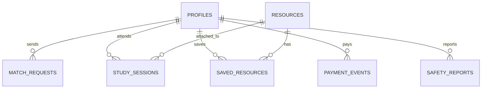

# StudyMatch — Nền Tảng Tự Động Ghép Đôi Bạn Học Bù Trừ Năng Lực & Phòng Học Kỷ Luật

> **Dành cho sinh viên đại học Việt Nam (HUST, FTU, UEH, v.v.)**  
> Vận hành theo nguyên tắc **"3 KHÔNG – 1 ĐÓNG"**:
> 1. **0% Bên thứ ba:** Tích hợp trực tiếp Video Call P2P (PeerJS/WebRTC), Bảng trắng HTML5 Canvas đồng bộ, Đồng hồ Pomodoro và Giám sát kỷ luật Anti-AFK ngay trên trình duyệt (có dự phòng Google Meet/Discord).
> 2. **0 Thao tác thủ công:** Tự động hóa 100% từ tính điểm tương thích bù trừ 4 tiêu chí $S = 0.35C + 0.30T + 0.20G + 0.15L$, tự động lên lịch đến đối soát kết thúc buổi học.
> 3. **Không thu phí vô nghĩa:** Gói cơ bản miễn phí (tối đa 3 lời mời), chỉ thu phí gói Mùa Thi (19.000đ/2 tuần) và Plus (29.000đ/tháng) với cơ chế neo giá (Price Anchoring) so với học phí học lại 2.400.000đ.
> 4. **1 Mạng lưới đóng:** Ưu tiên xác thực email sinh viên `.edu.vn` (gắn huy hiệu xanh xác thực); cho phép tài khoản `@gmail.com` vào với nhãn "Tài khoản Trải nghiệm" để không chặn người chấm thi.

---

## 1. HƯỚNG DẪN CHẠY ỨNG DỤNG

### Chế độ 1: Demo / Mock Tự Động (Zero-Config Fallback — MẶC ĐỊNH)
Ứng dụng được thiết kế kiến trúc **Dual-Mode** độc quyền:
- Khi chưa cấu hình `.env`, hệ thống tự động khởi tạo kho dữ liệu mô phỏng trong `localStorage` gồm **8 hồ sơ sinh viên HUST/FTU/UEH phong phú** và **15 tài liệu học tập chuẩn hóa**.
- Có sẵn nút chuyển nhanh vai trò (**Role Switcher**) ngay trên thanh điều hướng:
  - **SV A (Mất gốc / Trì hoãn):** Nguyễn Tuấn Anh (HUST) — Môn Giải tích 1, yếu Tích phân suy rộng, chuỗi số.
  - **SV B (Khá giỏi săn A/A+):** Trần Minh Đức (HUST) — Môn Giải tích 1, giỏi Tích phân suy rộng, có nhu cầu kèm bạn để nhớ sâu kiến thức.
- **Cam kết:** Ứng dụng chạy mượt mà 100% ngay lập tức, không bao giờ gặp lỗi màn hình trắng.

```bash
# Cài đặt thư viện (nếu clone mới)
npm install

# Khởi chạy máy chủ phát triển
npm run dev

# Ứng dụng mở tại: http://localhost:5173
```

---

### Chế độ 2: Kết Nối Supabase Live (PostgreSQL + Auth + Realtime)
Khi muốn kết nối với cơ sở dữ liệu đám mây Supabase:

1. Đăng ký tài khoản và tạo Project mới tại [https://supabase.com](https://supabase.com).
2. Tạo file `.env` tại thư mục gốc từ mẫu `.env.example`:
   ```env
   VITE_SUPABASE_URL=https://your-project-id.supabase.co
   VITE_SUPABASE_ANON_KEY=eyJhbGciOiJIUzI1NiIsInR5cCI...
   ```
3. Nạp SQL Migration và Dữ liệu mẫu:
   - Mở **SQL Editor** trong Supabase Dashboard.
   - Sao chép toàn bộ nội dung file `supabase/schema.sql` và bấm **Run**.
   - Tiếp tục sao chép toàn bộ nội dung file `supabase/seed.sql` và bấm **Run**.
4. Cấu hình Google OAuth trong Supabase:
   - Vào **Authentication** -> **Providers** -> Chọn **Google**.
   - Bật **Enable Google provider**, nhập **Client ID** và **Client Secret** từ Google Cloud Console.
   - Thêm Redirect URL của Supabase vào Google Cloud Console: `https://<your-project-id>.supabase.co/auth/v1/callback`.

---

## 2. KIẾN TRÚC 5 PHÂN HỆ CỐT LÕI

| Phân hệ | Tính năng chính & Logic nghiệp vụ |
| :--- | :--- |
| **Phân hệ 1: Đăng nhập, Hồ sơ 60s & Dashboard** | • Xác thực Google 1-click + tự động nhận diện đuôi `.edu.vn`<br>• Onboarding 60 giây dùng nút chọn/Chips (Môn học, Phần yếu, Phần vững, Cấp độ 1–3, Mục tiêu, Lưới rảnh 3 ca × 7 ngày)<br>• Dashboard hiển thị 3 việc cốt lõi: Hôm nay học gì, Học cùng ai, Buổi tiếp theo lúc nào<br>• Quỹ Cam Kết Kỷ Luật (50.000đ) & Chuỗi ngày học (Streak) |
| **Phân hệ 2: Ghép Bạn Học Tự Động (Smart Match)** | • Thuật toán tính điểm: $S = 0.35C + 0.30T + 0.20G + 0.15L$<br>• Thanh trượt mô phỏng trọng số tương tác thời gian thực (Interactive Weight Sliders)<br>• Top 1–3 ứng viên bù trừ sâu kiến thức<br>• Lý do ghép tường minh, tuyệt đối ẩn SĐT/Email<br>• Giới hạn 3 lời mời cho gói Free, tính năng Báo cáo/Chặn vi phạm |
| **Phân hệ 3: Thư Viện Môn Học (Resources)** | • 15 tài liệu chuẩn hóa Giải tích 1 (MI1111), Đại số (MI1141), Hóa đại cương (CH1015)<br>• Nhãn kiểm duyệt bản quyền học thuật<br>• Bộ lọc 3 cấp: Môn → Chương → Loại tài liệu<br>• 3 chế độ học tương tác: Ghi chú công thức, Flashcards lật 3D 2 mặt, Mini-Quiz trắc nghiệm tự chấm điểm kèm giải thích<br>• Nút chủ lực **"Gắn vào buổi học tiếp theo"** |
| **Phân hệ 4: Phòng Học Cam Kết (Study Room)** | • **Layout 3 cột chuẩn Desktop (chia tab trên Mobile):**<br>&nbsp;&nbsp;+ Cột trái (30%): Đồng hồ Pomodoro 25/50m đồng bộ + 02 Camera P2P WebRTC qua PeerJS (có tab dự phòng mở Google Meet/Discord)<br>&nbsp;&nbsp;+ Cột giữa (45%): Checklist 3 mục tiêu bài tập + Bảng trắng Canvas đồng bộ nét vẽ nhiều màu + Khung xem tài liệu đã gắn<br>&nbsp;&nbsp;+ Cột phải (25%): Bộ cảnh báo chống treo máy Anti-AFK (Page Visibility API, chuông Web Audio khi chuyển tab > 3 phút, có nút Test nhanh 5s) + Khung chat nội bộ có thanh ký hiệu Toán nhanh<br>• Đối soát cuối giờ: Hoàn trả 100% tiền cọc, tăng Streak, khảo sát giữ/đổi bạn học<br>• Nút mô phỏng "Báo vắng / Bùng học": Phạt 10.000đ (5.000đ đền bù bạn học, 5.000đ phí vận hành) |
| **Phân hệ 5: Tiến Độ & Kiểm Chứng Doanh Thu** | • Banner đối chiếu neo giá: Học lại 1 môn 3 tín chỉ HUST mất 2.400.000đ (nguy cơ cảnh cáo Mức 1) vs gói chỉ từ 19.000đ (~0,8%)<br>• 3 gói dịch vụ: Free (0đ, max 3 lời mời), Pass Mùa Thi (19.000đ/2 tuần), StudyMatch Plus (29.000đ/tháng)<br>• Thử nghiệm Fake Door Test: Ghi log vào `payment_events`, bật modal VietQR ngân hàng có nút "Tôi đã xác nhận đăng ký"<br>• Bảng Số liệu Đo lường Khởi nghiệp (Startup Metrics): Tổng clicks, lượt xác nhận, tỷ lệ CVR, GMV |

---

## 3. THIẾT KẾ CƠ SỞ DỮ LIỆU POSTGRESQL



- `profiles`: Hồ sơ sinh viên, kỹ năng bù trừ, lịch rảnh `free_slots`, số dư `commitment_deposit`, `free_invites_used`, `plan_tier`.
- `match_requests`: Yêu cầu ghép bạn, điểm tương thích $S$, lý do ghép, trạng thái `pending / accepted / rejected`.
- `study_sessions`: Phiên học cam kết, checklist 3 mục tiêu, `resource_id`, link Meet dự phòng, `afk_alert_count`.
- `resources`: 15 tài liệu học tập, công thức tóm tắt, mảng flashcards JSONB, mảng mini_quiz JSONB.
- `payment_events`: Ghi nhận sự kiện bấm mua gói (Fake Door Test), gói chọn, trạng thái người dùng bấm xác nhận chuyển khoản.
- `safety_reports`: Báo cáo vi phạm và danh sách chặn người dùng.

---

## 4. HƯỚNG DẪN TRIỂN KHAI LÊN VERCEL (MIỄN PHÍ)

Dự án đã tích hợp sẵn:
- `vercel.json`: Cấu hình rewrite Single Page Application (SPA) để không bị lỗi 404 khi người dùng refresh ở các route.
- `vite-plugin-pwa`: Tự động sinh `manifest.json` và Service Worker (`sw.js`) để người dùng có thể bấm **"Thêm vào màn hình chính" (Add to Home Screen)** dùng mượt như ứng dụng gốc trên điện thoại.

### Các bước đẩy lên Vercel:
1. Đẩy mã nguồn lên kho chứa GitHub.
2. Truy cập [https://vercel.com](https://vercel.com) -> Chọn **Add New Project** -> Chọn repository StudyMatch.
3. Trong phần **Build and Output Settings**:
   - Framework Preset: `Vite`
   - Build Command: `npm run build`
   - Output Directory: `dist`
4. Nếu kết nối Supabase Live, thêm các biến môi trường `VITE_SUPABASE_URL` và `VITE_SUPABASE_ANON_KEY` trong mục **Environment Variables** (nếu không thêm, ứng dụng sẽ chạy ở chế độ Demo 0-config hoàn hảo).
5. Bấm **Deploy**. Sau ~1 phút trang web sẽ online với chứng chỉ SSL HTTPS miễn phí!
