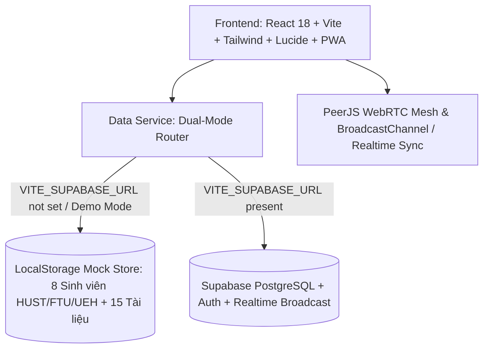

# KẾ HOẠCH TRIỂN KHAI DỰ ÁN STUDYMATCH (IMPLEMENTATION PLAN)

## 1. TỔNG QUAN DỰ ÁN & ĐỐI CHIẾU YÊU CẦU
StudyMatch là nền tảng Web Application tự động ghép đôi bạn học bù trừ năng lực và phòng học cam kết kỷ luật dành cho sinh viên đại học Việt Nam (tập trung sinh viên năm 1, 2 tại HUST, FTU, UEH,...).

### Nguyên tắc cốt lõi: "3 KHÔNG - 1 ĐÓNG"
1. **Không liên kết bên thứ ba:** Tích hợp sẵn Video P2P trực tiếp trên web (PeerJS/WebRTC), Bảng trắng HTML5 Canvas đồng bộ, Đồng hồ Pomodoro, Bộ giám sát chống xao nhãng Anti-AFK. Có tùy chọn dự phòng mở Meet/Discord khi mạng bị tường lửa chặn.
2. **Không thao tác thủ công:** Tự động hóa từ chấm điểm bù trừ kiến thức, đề xuất Top 1–3, xác nhận tham gia, đến đối soát hoàn cọc / trừ cọc.
3. **Không thu phí xem danh sách vô nghĩa:** Gói cơ bản miễn phí (tối đa 3 lời mời), chỉ thu phí gói Mùa Thi (19.000đ/2 tuần) và Plus (29.000đ/tháng) với cơ chế neo giá (Price Anchoring) so với học phí học lại 2.400.000đ.
4. **1 Mạng lưới đóng:** Ưu tiên xác thực email sinh viên `.edu.vn` (gắn huy hiệu xác thực); tài khoản `@gmail.com` gắn nhãn "Tài khoản Trải nghiệm" không chặn người chấm thi.

---

## 2. KIẾN TRÚC HỆ THỐNG DUAL-MODE (HYBRID ARCHITECTURE)



- **Chế độ Demo / Mock Zero-Config Fallback:** Tự động phát hiện khi chưa thiết lập biến môi trường `.env`. Khởi tạo 8 hồ sơ sinh viên chân thực (gồm Sinh viên A mất gốc/trì hoãn, Sinh viên B giỏi săn học bổng A/A+, cùng sinh viên FTU, UEH, HUST), 15 tài liệu học tập đầy đủ công thức, flashcards và mini-quiz. Kèm thanh Switch Role (Chuyển vai SV A / SV B) tức thì trên Header.
- **Chế độ Live Supabase:** Kết nối PostgreSQL, Supabase Auth (Google OAuth 1-click), Supabase Realtime channel cho Bảng trắng và Pomodoro.

---

## 3. CƠ SỞ DỮ LIỆU & SCHEMA POSTGRESQL (/supabase/schema.sql & seed.sql)

### 3.1. Các bảng chính
1. `profiles`:
   - `id`: UUID (PK, FK auth.users)
   - `display_name`: TEXT
   - `university`: TEXT
   - `is_edu_verified`: BOOLEAN (True nếu email có đuôi .edu.vn)
   - `priority_subject`: TEXT ('MI1111 - Giải tích 1' | 'MI1141 - Đại số' | 'CH1015 - Hóa học đại cương')
   - `weak_topics`: TEXT[]
   - `strong_topics`: TEXT[]
   - `self_level`: INT (1: Mất gốc, 2: Cơ bản, 3: Khá muốn ôn sâu)
   - `learning_goal`: TEXT ('Cùng giải bài tập' | 'Ôn lý thuyết qua môn' | 'Luyện đề đạt A/A+')
   - `learning_style`: TEXT ('Thảo luận sôi nổi' | 'Pomodoro yên lặng' | 'Hỏi đáp nhanh phần khó')
   - `free_slots`: TEXT[] (ví dụ: `["T2_TOI", "T4_TOI", "T6_TOI"]`)
   - `streak_days`: INT (default 0)
   - `total_study_minutes`: INT (default 0)
   - `commitment_deposit`: INT (default 50000)
   - `free_invites_used`: INT (default 0)
   - `plan_tier`: TEXT ('free' | 'sprint' | 'plus')
   - `created_at`: TIMESTAMPTZ
   - *Bảo mật:* Tuyệt đối không trả về `email` hoặc `phone` trong public queries.

2. `match_requests`:
   - `id`: UUID (PK)
   - `sender_id`: UUID (FK profiles.id)
   - `receiver_id`: UUID (FK profiles.id)
   - `compatibility_score`: NUMERIC
   - `match_reason`: TEXT
   - `status`: TEXT ('pending' | 'accepted' | 'rejected')
   - `created_at`: TIMESTAMPTZ

3. `study_sessions`:
   - `id`: UUID (PK)
   - `user_a_id`: UUID (FK profiles.id)
   - `user_b_id`: UUID (FK profiles.id)
   - `subject`: TEXT
   - `topic`: TEXT
   - `scheduled_slot`: TEXT
   - `duration_minutes`: INT (25 | 50)
   - `user_a_confirmed`: BOOLEAN (default false)
   - `user_b_confirmed`: BOOLEAN (default false)
   - `goals_checklist`: JSONB (Mảng 3 mục tiêu bài tập `{ id, text, completed }`)
   - `resource_id`: UUID (FK resources.id, nullable)
   - `external_meet_url`: TEXT (link Meet/Discord dự phòng)
   - `status`: TEXT ('upcoming' | 'completed' | 'missed')
   - `partner_retention_choice`: TEXT ('keep' | 'change' | null)
   - `afk_alert_count`: INT (default 0)
   - `created_at`: TIMESTAMPTZ

4. `resources`:
   - `id`: UUID (PK)
   - `subject`: TEXT
   - `topic`: TEXT
   - `resource_type`: TEXT ('Ghi chú' | 'Bài tập' | 'Đề ôn tập')
   - `title`: TEXT
   - `copyright_verified`: BOOLEAN (default true)
   - `content_markdown`: TEXT
   - `formula_summary`: TEXT
   - `flashcards`: JSONB (Mảng `{ front, back }`)
   - `mini_quiz`: JSONB (Mảng 3-5 câu `{ question, options[], correctIndex, explanation }`)

5. `saved_resources`:
   - `user_id`: UUID (FK profiles.id)
   - `resource_id`: UUID (FK resources.id)
   - `created_at`: TIMESTAMPTZ

6. `payment_events`:
   - `id`: UUID (PK)
   - `user_id`: UUID (FK profiles.id)
   - `plan_code`: TEXT ('plus_29k' | 'sprint_19k')
   - `amount`: INT (29000 | 19000)
   - `user_confirmed_transfer`: BOOLEAN (default false)
   - `clicked_at`: TIMESTAMPTZ

7. `safety_reports`:
   - `id`: UUID (PK)
   - `reporter_id`: UUID (FK profiles.id)
   - `reported_user_id`: UUID (FK profiles.id)
   - `action_type`: TEXT ('report' | 'block')
   - `reason`: TEXT
   - `created_at`: TIMESTAMPTZ

---

## 4. THUẬT TOÁN GHÉP ĐÔI SMART MATCH
Công thức tính điểm tương thích $S \in [0, 100]$:
$$S = 0.35C + 0.30T + 0.20G + 0.15L$$

1. **C (35% — Môn học & Bù trừ kiến thức):**
   - Khác môn ưu tiên $\to C = 0$.
   - Cùng môn $\to$ cơ sở $50$ điểm.
   - Cộng thêm $50$ điểm ($C = 100$) nếu:
     - Hai bên bù trừ chéo: yếu của A nằm trong mạnh của B VÀ/HOẶC yếu của B nằm trong mạnh của A; HOẶC
     - 1 người có chủ đề yếu và đối phương có `self_level = 3` (Khá muốn ôn sâu); HOẶC
     - Có chung ít nhất 1 chủ đề yếu cùng muốn giải bài tập.
2. **T (30% — Lịch rảnh trùng nhau):**
   - Số ca rảnh trùng $k = |free\_slots_A \cap free\_slots_B|$.
   - $k \ge 2 \to T = 100$.
   - $k = 1 \to T = 50$.
   - $k = 0 \to T = 0$.
3. **G (20% — Mục tiêu học tập):**
   - Giống nhau hoàn toàn $\to G = 100$. Khác nhau $\to G = 50$.
4. **L (15% — Phong cách học):**
   - Giống nhau hoàn toàn $\to L = 100$. Khác nhau $\to L = 40$.

**Mô phỏng tương tác trọng số:** Cung cấp Slider thay đổi tỷ lệ $w_C, w_T, w_G, w_L$ (tự động chuẩn hóa tổng 100%) và nút Reset về mặc định 35-30-20-15.

---

## 5. CẤU TRÚC THƯ MỤC DỰ ÁN

```
d:/DỰ ÁN STUDYMATCH/
├── public/
│   ├── favicon.svg
│   ├── pwa-192x192.png
│   ├── pwa-512x512.png
│   └── manifest.json
├── src/
│   ├── components/
│   │   ├── layout/
│   │   │   ├── Navbar.tsx
│   │   │   ├── RoleSwitcher.tsx
│   │   │   └── Toast.tsx
│   │   ├── dashboard/
│   │   │   ├── HeroTodayCard.tsx
│   │   │   ├── PendingInvites.tsx
│   │   │   ├── StreakFundBadge.tsx
│   │   │   └── QuickProfileModal.tsx
│   │   ├── matching/
│   │   │   ├── WeightSliders.tsx
│   │   │   ├── CandidateCard.tsx
│   │   │   └── ReportBlockModal.tsx
│   │   ├── resources/
│   │   │   ├── ResourceFilter.tsx
│   │   │   ├── ResourceCard.tsx
│   │   │   ├── FlashcardViewer.tsx
│   │   │   └── MiniQuizModal.tsx
│   │   ├── studyroom/
│   │   │   ├── PreSessionBanner.tsx
│   │   │   ├── PomodoroTimer.tsx
│   │   │   ├── P2PCameraMesh.tsx
│   │   │   ├── CollaborativeWhiteboard.tsx
│   │   │   ├── ChecklistGoals.tsx
│   │   │   ├── AntiAfkMonitor.tsx
│   │   │   ├── InRoomChat.tsx
│   │   │   └── PostSessionModal.tsx
│   │   └── pricing/
│   │       ├── PriceAnchoringBanner.tsx
│   │       ├── PricingTierCards.tsx
│   │       ├── PaymentQrModal.tsx
│   │       └── StartupMetricsModal.tsx
│   ├── data/
│   │   ├── mockProfiles.ts
│   │   ├── mockResources.ts
│   │   └── subjectsCatalog.ts
│   ├── hooks/
│   │   ├── useAuth.ts
│   │   ├── useStudySession.ts
│   │   └── useAntiAfk.ts
│   ├── services/
│   │   ├── supabaseClient.ts
│   │   ├── dataService.ts
│   │   └── matchingEngine.ts
│   ├── types/
│   │   └── index.ts
│   ├── App.tsx
│   ├── main.tsx
│   └── index.css
├── supabase/
│   ├── schema.sql
│   └── seed.sql
├── package.json
├── tsconfig.json
├── vite.config.ts
├── tailwind.config.js
├── vercel.json
└── README.md
```

---

## 6. TIẾN TRÌNH THỰC HIỆN CÁC PHÂN HỆ
- [x] Bước 1: Kế hoạch triển khai (implementation_plan.md).
- [ ] Bước 2: Khởi tạo Project Vite + React + TS + Tailwind + Lucide + PeerJS.
- [ ] Bước 3: Dữ liệu chuẩn hóa (15 Resources, 8 Profiles) & DataService Dual-Mode.
- [ ] Bước 4: Viết SQL Schema và Seed data cho Supabase.
- [ ] Bước 5: Phát triển 5 phân hệ UI + Phòng học P2P + Bảng trắng Canvas + Anti-AFK.
- [ ] Bước 6: PWA + Vercel config + Build test và kiểm tra toàn diện.
